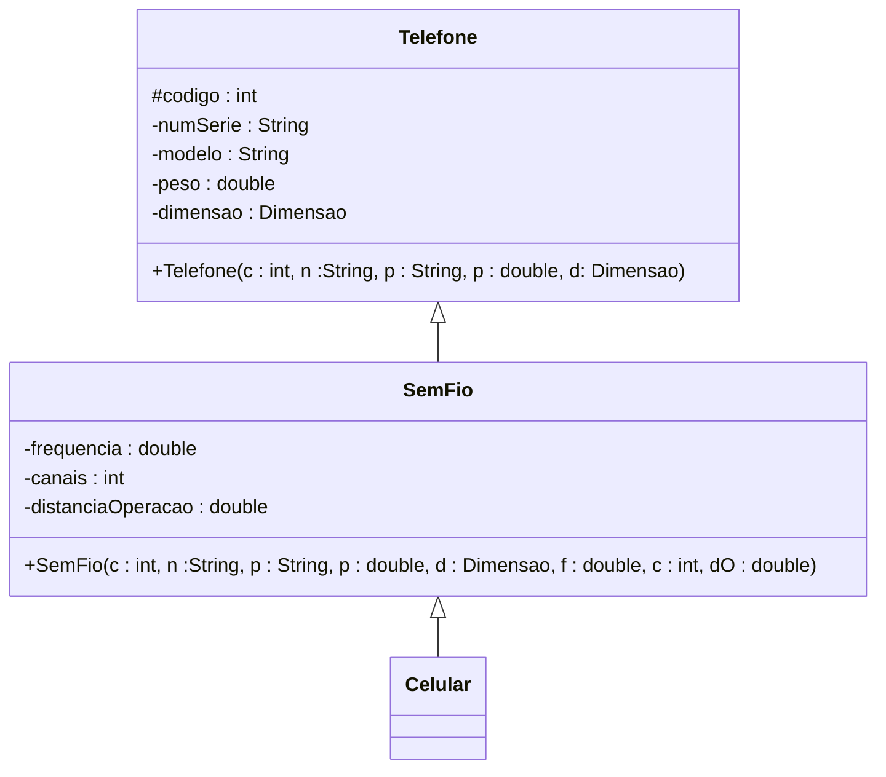
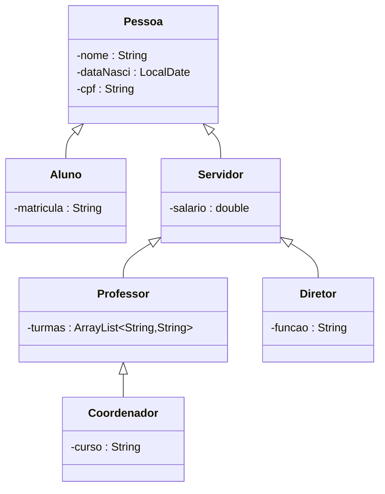
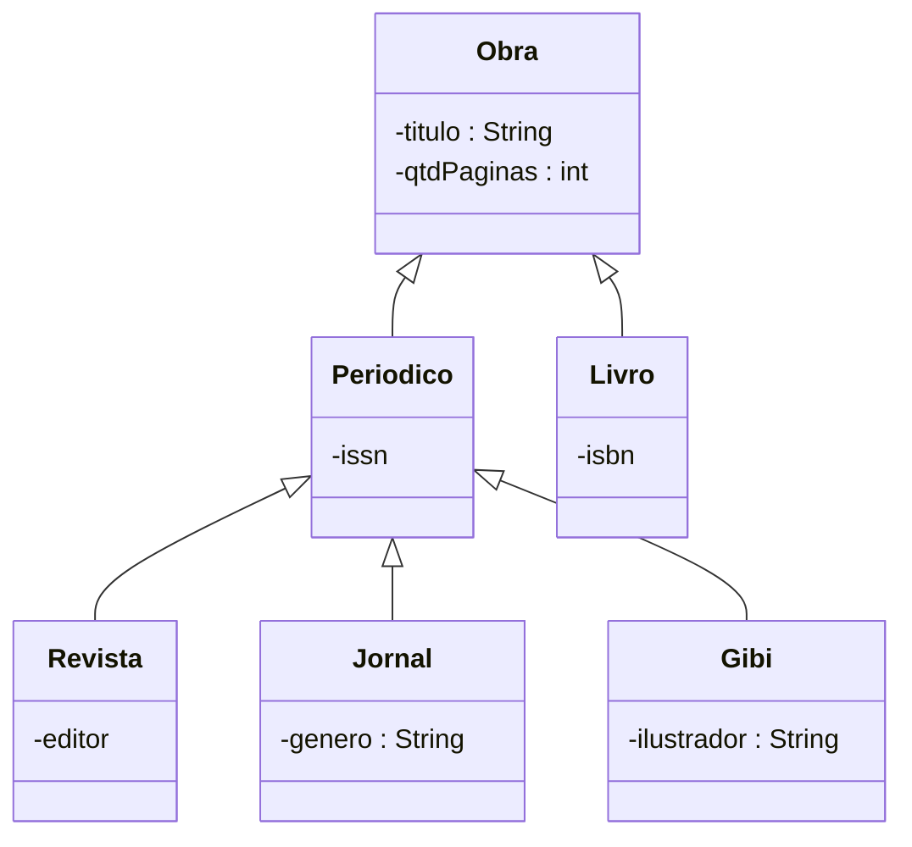
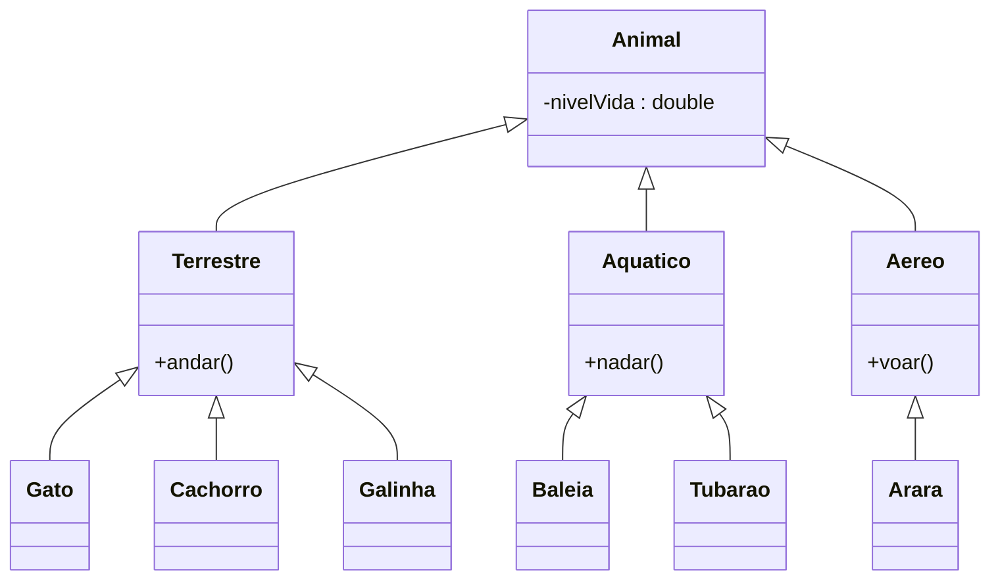

# Exemplo 1:

# Exercícios:

## Exercício 1:

- Informações: Aluno, professor, coordenador, diretor

Contexto pensado: Sistema academico

## Exercício 2:

- Informações: Livro, revista, jornal, gibi

Contexto: livraria

## Exercício 4:

- Informações: Gato, Cachorro, Arara, Galinha, Baleia, Tubarao

Contexto: jogo

