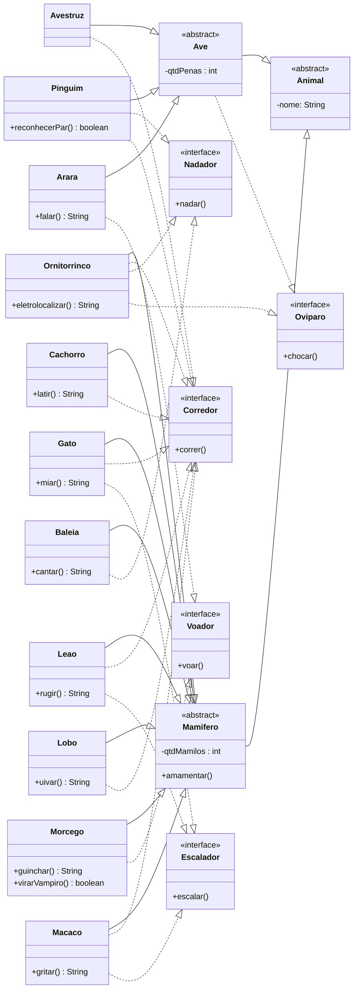

- Faça um diagrama UML com classes e interfaces que permitam representar animais em um jogo
    - Arara, Avestruz, Baleia, Cachorro, Gato, Leão, Lobo, Macaco, Morcego, Pinguim, Ornitorrinco
- Todo animal possui um nome e no mínimo 2 métodos de habilidade, ou seja, ações que o animal pode realizar
    - Exemplo: cachorro late e corre, arara voa e fala, leão ruge e corre
    - Método toString deve retornar o nome do animal e de qual classe ele é. Exemplo: “Totó é um cachorro”
- Organize as classes e interfaces em uma hierarquia de forma que seja possível criar um vetor de animais e chamar suas
  habilidades usando polimorfismo
- Crie uma classe App para testar a implementação

